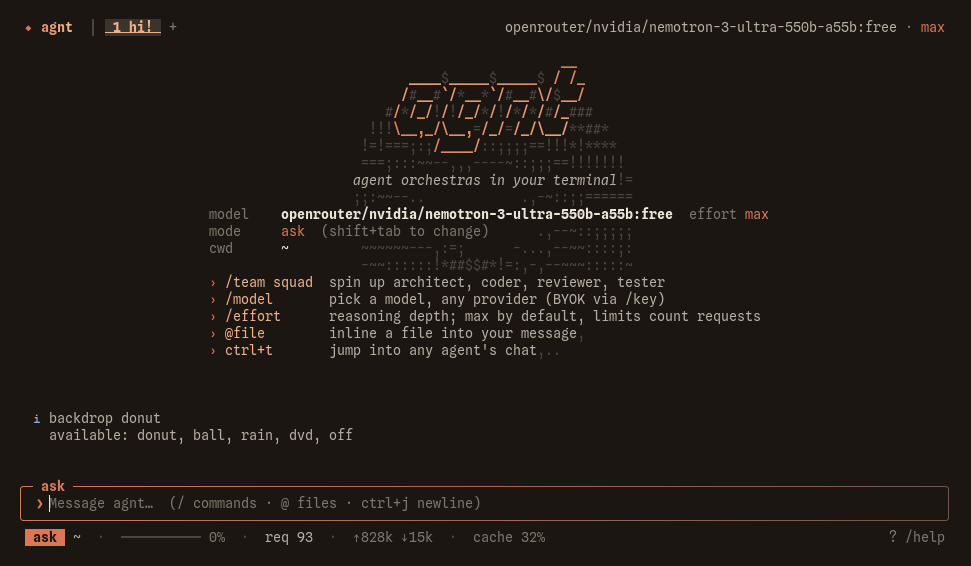

<div align="center">


```
                     __
  ____ _____ _____  / /_
 / __ `/ __ `/ __ \/ __/
/ /_/ / /_/ / / / / /_
\__,_/\__, /_/ /_/\__/
     /____/
```


**AI coding agent for your terminal. Teams of agents in parallel, on any model.**

[](https://github.com/mozzarellabio/agnt/releases)
[](https://github.com/mozzarellabio/agnt/releases)
[](https://mozzarellabio.github.io/agnt/free-claude-code-alternative.html)
[](https://mozzarellabio.github.io/agnt/)

[Website](https://mozzarellabio.github.io/agnt/) · [Docs](https://mozzarellabio.github.io/agnt/docs.html) · [Local models](https://mozzarellabio.github.io/agnt/ollama.html) · [Changelog](https://mozzarellabio.github.io/agnt/changelog.html)

</div>

<br>



<br>

> Not to be confused with [agnt-gg/agnt](https://github.com/agnt-gg/agnt), an unrelated agent operating system.

## Install

**Linux**

```sh
curl -fsSL https://raw.githubusercontent.com/mozzarellabio/agnt/main/install.sh | sh
```

**Windows (PowerShell)**

```powershell
irm https://raw.githubusercontent.com/mozzarellabio/agnt/main/install.ps1 | iex
```

Then run `agnt`, use `/key` to store an API key (or `/model` to pick a local model), and start typing.

## Why agnt

| | |
|---|---|
| **Parallel teams** | `/team` seats an architect, coder, reviewer and tester working at once. Talk to any of them mid-run. |
| **Any model** | Anthropic, OpenAI, OpenRouter, Gemini, DeepSeek, Groq, xAI, Mistral, Ollama, LM Studio, or any OpenAI-compatible endpoint. |
| **Fewer requests** | Batched tool calls, parallel reads, prompt caching, context compaction. |
| **Self-verifying** | Diagnostics after every edit; typecheck and tests run before it finishes. |
| **Safe by default** | Modes: ask, auto, plan, free. Allow/deny rules, `/undo`, `/rewind`, git worktrees. |
| **Extensible** | MCP servers, plugins, skills, hooks, scheduled prompts. |
| **Remote** | `/rc` opens your session on your phone through a QR code. |
| **One binary** | Linux and Windows. No runtime to install. |

## Commands

| Area | Commands |
|---|---|
| Models | `/key` `/model` `/provider` `/fallback` `/effort` |
| Teams | `/team` `/spawn` `/agents` `/focus` `/orch` `/board` `/map` |
| Safety | `/mode` `/allow` `/deny` `/undo` `/redo` `/rewind` `/worktree` |
| Git | `/commit` `/pr` `/issue` `/checks` `/review` `/diff` `/branch` |
| Sessions | `/new` `/sessions` `/compact` `/context` `/stats` `/export` |
| Extend | `/mcp` `/plugin` `/skills` `/schedule` `/loop` |

Full reference: [docs](https://mozzarellabio.github.io/agnt/docs.html).

## Guides

- [What is agnt?](https://mozzarellabio.github.io/agnt/what-is-agnt.html)
- [Run multiple coding agents in parallel](https://mozzarellabio.github.io/agnt/multi-agent-coding.html)
- [A free terminal agent for any model](https://mozzarellabio.github.io/agnt/free-claude-code-alternative.html)
- [Run on Ollama or LM Studio](https://mozzarellabio.github.io/agnt/ollama.html)
- [What to compare in a coding agent](https://mozzarellabio.github.io/agnt/compare.html)
